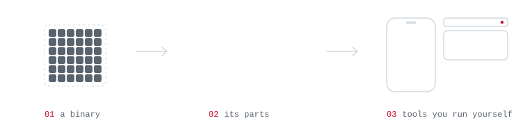
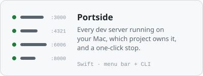
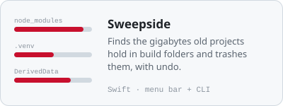

<picture><source media="(prefers-color-scheme: dark)" srcset="assets/header-dark.svg"></picture>

### I take software apart, and I build tools that run on your own device.

Software engineer at NxP Studio. Five years across Android, systems and web, mostly in Kotlin, Swift, C++ and TypeScript. What I ship tends to work offline, ask for no account and send nothing anywhere.

[Website](https://springmusk.dev) · [Blog](https://basantasapkota026.com.np) · [LinkedIn](https://np.linkedin.com/in/basanta-sapkota-57529923b) · [Telegram](https://t.me/springmusk) · [Email](mailto:springmusk@gmail.com)

<br>

<picture><source media="(prefers-color-scheme: dark)" srcset="assets/flow-dark.svg"></picture>

## Taken apart

<a href="https://github.com/springmusk026/Il2CppDumper-Python"><picture><source media="(prefers-color-scheme: dark)" srcset="assets/card-il2cpp-dark.svg"></picture></a> <a href="https://github.com/springmusk026/Dex2C-Tool"><picture><source media="(prefers-color-scheme: dark)" srcset="assets/card-dex2c-dark.svg"></picture></a>

## Built for the phone

<a href="https://github.com/springmusk026/locus"><picture><source media="(prefers-color-scheme: dark)" srcset="assets/card-locus-dark.svg"></picture></a> <a href="https://github.com/springmusk026/AntiBloater"><picture><source media="(prefers-color-scheme: dark)" srcset="assets/card-antibloater-dark.svg"></picture></a> <a href="https://github.com/springmusk026/Composdown"><picture><source media="(prefers-color-scheme: dark)" srcset="assets/card-composdown-dark.svg"></picture></a> <a href="https://github.com/springmusk026/tithimala"><picture><source media="(prefers-color-scheme: dark)" srcset="assets/card-tithimala-dark.svg"></picture></a>

## Built for the menu bar

<a href="https://github.com/springmusk026/Portside"><picture><source media="(prefers-color-scheme: dark)" srcset="assets/card-portside-dark.svg"></picture></a> <a href="https://github.com/springmusk026/Sweepside"><picture><source media="(prefers-color-scheme: dark)" srcset="assets/card-sweepside-dark.svg"></picture></a> <a href="https://github.com/springmusk026/Peekside"><picture><source media="(prefers-color-scheme: dark)" srcset="assets/card-peekside-dark.svg"></picture></a> <a href="https://github.com/springmusk026/ClaudeMeter"><picture><source media="(prefers-color-scheme: dark)" srcset="assets/card-claudemeter-dark.svg"></picture></a>

```sh
brew install springmusk026/tap/portside
```

<details>
<summary>Everything as plain text</summary>
<br>

**Reverse engineering.**
[Il2CppDumper-Python](https://github.com/springmusk026/Il2CppDumper-Python),
[Frida-Il2cpp-Dumper](https://github.com/springmusk026/Frida-Il2cpp-Dumper) for running processes,
[Android-Native-Il2cppDumper](https://github.com/springmusk026/Android-Native-Il2cppDumper) for dumping on the phone itself,
[Dex2C](https://github.com/springmusk026/Dex2C-Tool) with its [Android](https://github.com/springmusk026/Dex2C-Android), [web](https://github.com/springmusk026/dex2c-web) and [backend](https://github.com/springmusk026/Dex2C-Backend) parts,
[Imgui-Unity](https://github.com/springmusk026/Imgui-Unity) and
[libmain.so](https://github.com/springmusk026/libmain.so).

**Android.**
[Locus](https://github.com/springmusk026/locus),
[AntiBloater](https://github.com/springmusk026/AntiBloater),
[Composdown](https://github.com/springmusk026/Composdown) and
[Tithimala](https://github.com/springmusk026/tithimala).

**Mac.**
[Portside](https://github.com/springmusk026/Portside),
[Sweepside](https://github.com/springmusk026/Sweepside),
[Peekside](https://github.com/springmusk026/Peekside) and
[ClaudeMeter](https://github.com/springmusk026/ClaudeMeter).

**Web.**
[CloudEdge](https://github.com/springmusk026/CloudEdge), a blog and CMS that runs entirely on Cloudflare.
[Anthropic-Adapter](https://github.com/springmusk026/Anthropic-Adapter), which forwards Anthropic Messages API requests to an OpenAI-compatible backend.
[Open-Monitor-YT](https://github.com/springmusk026/Open-Monitor-YT), a self-hosted watcher for competing YouTube channels.

</details>

## Writing

I write about Android, AI tools and tech in Nepal at [basantasapkota026.com.np](https://basantasapkota026.com.np).

<!-- BLOG-POST-LIST:START -->
- [Google finally added new Claude models to Antigravity after the 4.6 series](https://www.basantasapkota026.com.np/2026/10/google-finally-added-new-claude-models.html)
- [Nepal&#39;s Government Tech Workers Are Failing Us: SSL Lapses, Data Leaks, and AI Slop Everywhere](https://www.basantasapkota026.com.np/2026/10/nepals-government-tech-workers-are.html)
- [Internet in Nepal Is Cheap — But at What Cost?](https://www.basantasapkota026.com.np/2026/09/internet-in-nepal-is-cheap-but-at-what.html)
- [Googlebook Is Here: Android Finally Comes to Your Laptop](https://www.basantasapkota026.com.np/2026/09/googlebook-is-here-android-finally.html)
- [Who Really Wants to Slow Down AI — And Why You Should Be Suspicious](https://www.basantasapkota026.com.np/2026/09/who-really-wants-to-slow-down-ai-and.html)
<!-- BLOG-POST-LIST:END -->

<br>

<a href="https://t.me/springmusk"><picture><source media="(prefers-color-scheme: dark)" srcset="assets/footer-dark.svg"></picture></a>

Telegram is fastest: [@springmusk](https://t.me/springmusk). For anything longer, write to [springmusk@gmail.com](mailto:springmusk@gmail.com).
